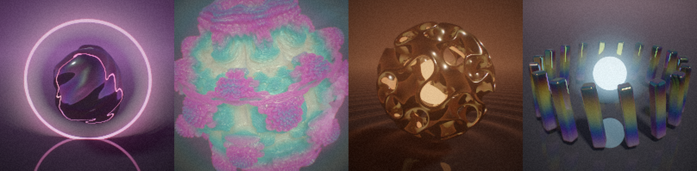

# FLUXION

**Node-based 3D motion design in the browser, running on the GPU (WebGPU).**

You wire nodes together and the graph is compiled live into one GPU shader. Every parameter can be animated: springs, LFOs, wiggles, BPM pulses and keyframe curves plug into any socket. 3D shapes are raymarched signed distance fields, so you get gooey blends, infinite repetition and fractals.




*The four built-in demos, rendered by the app on a software GPU at low resolution.*

## Run it

```bash
npm install
```

```bash
npm run dev
```

Open the printed URL in **Chrome, Edge or Arc (desktop)**, or **Safari 26+**. WebGPU is required for the viewport; the node editor works without it.

Slow GPU? Add `?scale=0.5` to the URL to cap the render resolution.

## What's in Phase 0

| Area | Features |
|---|---|
| **Renderer** | SDF raymarcher, GGX shading, soft shadows, AO, real reflections, thin-film iridescence, volumetric emissive glow, fog, procedural sky |
| **Post** | Physically based bloom (13-tap mip chain), AgX tone mapping, chromatic aberration, film grain, vignette |
| **Quality** | Dynamic resolution while moving; when still it renders at full res with progressive jittered supersampling (up to 96 spp) |
| **Graph compiler** | Graph → WGSL. Signals run on the CPU and fields/shapes on the GPU, inferred automatically. All values are uniforms, so dragging a slider never recompiles; only wiring changes do, and the old shader keeps rendering until the new one is ready |
| **Signals** | Time, LFO (5 waves), Wiggle (fractal noise), Pulse (BPM envelope), Spring (physical, with **deterministic scrubbing**), Keyframes (inline curve editor, smooth/linear/expo/back/step, loop/ping-pong) |
| **Shapes** | Sphere, Box, Torus, Octahedron, Floor, Gyroid, Mandelbulb |
| **Combine / Deform** | Smooth Union / Subtract / Intersect, Morph, Transform, Twist, Bend, Repeat, Radial Array, Mirror, Displace, Shell |
| **Fields & Math** | Position, Noise Field, Wave Field, Distance, Math (13 ops), Remap, Vector, Component, Color, Palette (6 cosine presets), Mix Color |
| **Editor** | Pan/zoom canvas, typed colored sockets, drag-to-connect, re-route by dragging an input, drop a wire on empty space to get a filtered node search, scrubbable number fields (Shift = fine, Ctrl = coarse, click to type math like `2*pi`), live sparklines on signals, live values on wires, CPU/GPU badges |
| **Workflow** | Undo/redo, copy/paste/duplicate, autosave, save/open `.flux.json`, **share links** (the whole graph compressed into the URL), PNG snapshot, timeline with scrub and loop |

## Shortcuts

| Key | Action |
|---|---|
| `Tab` / `A` / double-click | Add node (in the node editor) |
| `Space` | Play / pause |
| `Home` | Back to start |
| `Delete` | Delete selected nodes |
| `Ctrl+D` / `Ctrl+C` / `Ctrl+V` | Duplicate / copy / paste |
| `Ctrl+Z` / `Ctrl+Shift+Z` | Undo / redo |
| `Ctrl+S` | Save file |
| `F` | Frame all nodes |
| `` ` `` | Maximize viewport |

Viewport controls: drag to orbit, Shift-drag or right-drag to pan, wheel to zoom, double-click to reset the camera.

## Architecture

```
src/
  graph/
    types.ts       socket types, document format
    registry.ts    every node: inputs, CPU impl, WGSL impl
    graph.ts       editing ops, cycle checks, topo sort
    evaluate.ts    CPU/GPU domain inference + deterministic signal evaluator
    compile.ts     graph -> WGSL, uniform slot allocation
    history.ts     undo/redo
  gpu/
    shaders.ts     WGSL: SDF library, raymarcher, bloom, AgX composite
    renderer.ts    WebGPU pipelines, ping-pong accumulation, capture
  editor/          node editor, widgets, quick-add palette
  ui/              timeline, orbit camera
  demos.ts         built-in scenes
```

Every GPU node compiles to `fn nID(p: vec3f) -> T`. Deformers call their input at a transformed position (`n12(q)`), so space warps compose naturally. Unconnected inputs and CPU signals become slots in one uniform array.

## Tests

```bash
npm test
```

```bash
npm run dev
```

```bash
node scripts/validate-shaders.mjs
```

`npm test` covers the graph core, compiler and signal determinism. With the dev server running, `validate-shaders.mjs` compiles every demo plus a graph that uses every node type through real WebGPU in headless Chromium.

## Roadmap

See [GAMEPLAN.md](GAMEPLAN.md). Next up is Phase 1: GPU particles, fields and effectors, audio-reactive nodes, live per-node thumbnails and video export.
