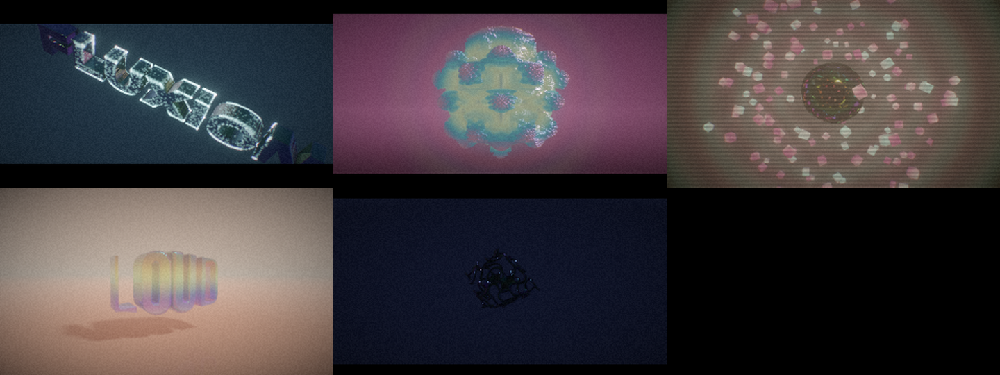

# FLUXION

**Node-based 3D motion design in the browser, running on the GPU (WebGPU).**

You wire nodes together and the graph is compiled live into one GPU shader. Every parameter can be animated: springs, LFOs, wiggles, BPM pulses and keyframe curves plug into any socket. 3D shapes are raymarched signed distance fields, so you get gooey blends, infinite repetition and fractals.





*Built-in demos, rendered by the app itself on a software GPU at low resolution.*

## Try it

**Live:** https://derflowx.github.io/awesome/ (Chrome, Edge or Arc on desktop)

## Run it locally

```bash
npm install
```

```bash
npm run dev
```

Open the printed URL in **Chrome, Edge or Arc (desktop)**, or **Safari 26+**. WebGPU is required for the viewport; the node editor works without it.

Slow GPU? Add `?scale=0.5` to the URL to cap the render resolution.

## Features

### Motion design (Phase 1)
| Area | Features |
|---|---|
| **3D Text** | Any word in 7 Google fonts (display, grotesk, serif italic, condensed, mono, sans, script), extruded with bevel. Baked to a signed distance field, so it melts, twists, displaces and morphs like any other shape |
| **Reveal** | Animated build-ons with a glowing edge: wipe, radial, dissolve, slices. Wire Keyframes into `progress` |
| **Shots** | Cuts between up to 4 shapes on a timer with transitions: dissolve, pop, swirl, slice, wipe, morph |
| **Director camera** | Automatic cinematography: orbit, push-in, crane, fly-by, spiral, top-down, vertigo (dolly zoom), auto-mixed per shot with dutch angles, smooth / hard cut / whip transitions, handheld shake, arc limit. Or wire your own Camera node. `C` toggles director / free camera |
| **GPU particles** | Up to 1M particles in curl-noise flow, simulated in a compute shader that reads your scene, so they **cling to and crawl over** shapes and text, collide, fall and burst. Emitters: surface, sphere, ring, burst, rain. Depth-aware glow |
| **Audio** | Drop a track on the canvas: it is analysed offline into bass / mid / high / level / beat, so scrubbing and export are exact. Without a track, a built-in 120 BPM groove drives the demos |
| **Lens FX** | Glitch (block tearing, RGB split, scanlines), flash, hue shift, cinematic letterbox, on top of bloom, AgX, aberration, grain, vignette |
| **Scatter** | Random instancing: jitter, scale, spin, density, evolve |
| **MP4 export** | Offline render with up to 16× sub-frame motion blur + supersampling, 720p to 4K, 9:16 / 4:5 / 1:1, 24/30/60 fps, audio muxed in. H.264 (VP9 fallback) |

### UI
- **The render is the app**: the canvas fills the window and the editor floats over it as glass. The camera's lens is shifted so the subject stays centred in the visible area.
- **Art-reactive colour**: accents (logo, buttons, timeline, selection, sliders) are sampled live from your render.
- Wires carrying signals pulse with their values. Nodes spring in. Drop files anywhere on the canvas.

### Core (Phase 0)
| Area | Features |
|---|---|
| **Renderer** | SDF raymarcher, GGX shading, soft shadows, AO, real reflections, thin-film iridescence, volumetric emissive glow, fog, procedural sky |
| **Quality** | Dynamic resolution while moving; when still it renders at full res with progressive jittered supersampling (up to 96 spp) |
| **Graph compiler** | Graph → WGSL. Signals run on the CPU and fields/shapes on the GPU, inferred automatically. Values are uniforms, so dragging a slider never recompiles |
| **Signals** | Time, LFO, Wiggle, Pulse, Spring (deterministic scrubbing), Keyframes (inline curve editor), Audio |
| **Shapes** | Text, Sphere, Box, Torus, Octahedron, Floor, Gyroid, Mandelbulb |
| **Combine / Deform** | Union / Subtract / Intersect (smooth), Morph, Shots, Transform, Twist, Bend, Repeat, Radial Array, Mirror, Displace, Shell, Scatter, Reveal |
| **Fields & Math** | Position, Noise, Wave, Distance, Math, Remap, Vector, Component, Color, Palette, Mix Color |
| **Workflow** | Undo/redo, copy/paste, autosave, save/open, share links (graph in the URL), PNG snapshots |

## Shortcuts

| Key | Action |
|---|---|
| `Tab` / `A` / double-click | Add node (in the node editor) |
| `Space` | Play / pause |
| `Home` | Back to start |
| `Delete` | Delete selected nodes |
| `Ctrl+D` / `Ctrl+C` / `Ctrl+V` | Duplicate / copy / paste |
| `Ctrl+Z` / `Ctrl+Shift+Z` | Undo / redo |
| `Ctrl+S` | Save file |
| `F` | Frame all nodes |
| `` ` `` | Focus mode (hide panels) |
| `C` | Director / free camera |

Viewport controls: drag to orbit, Shift-drag or right-drag to pan, wheel to zoom, double-click to reset the camera.

## Architecture

```
src/
  graph/
    types.ts       socket types, document format
    registry.ts    every node: inputs, CPU impl, WGSL impl
    graph.ts       editing ops, cycle checks, topo sort
    evaluate.ts    CPU/GPU domain inference + deterministic signal evaluator
    compile.ts     graph -> WGSL, uniform slot allocation
    history.ts     undo/redo
  gpu/
    shaders.ts     WGSL: SDF library, text SDF, raymarcher, particles, bloom, AgX + lens FX
    renderer.ts    WebGPU pipelines, accumulation, particles, capture, palette readback
    textAtlas.ts   text -> signed distance field atlas (exact EDT)
  audio/           offline FFT analysis + playback synced to the timeline
  export/          WebCodecs MP4 export with motion blur
  engine.ts        builds a frame from the graph (shared by live view and export)
  editor/          node editor, widgets, quick-add palette
  ui/              timeline, orbit camera
  demos.ts         built-in scenes
```

Every GPU node compiles to `fn nID(p: vec3f) -> T`. Deformers call their input at a transformed position (`n12(q)`), so space warps compose naturally. Unconnected inputs and CPU signals become slots in one uniform array.

## Tests

```bash
npm test
```

```bash
npm run dev
```

```bash
node scripts/validate-shaders.mjs
```

`npm test` covers the graph core, compiler and signal determinism. With the dev server running, `validate-shaders.mjs` compiles every demo plus a graph that uses every node type through real WebGPU in headless Chromium.

## Roadmap

See [GAMEPLAN.md](GAMEPLAN.md). Next up: live per-node thumbnails, Evolve mode, motion brush, inline WGSL code node, AI copilot.
